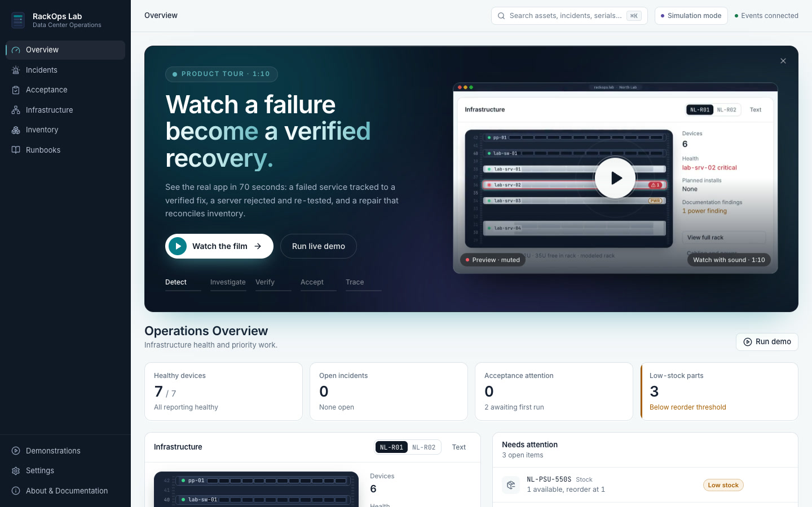
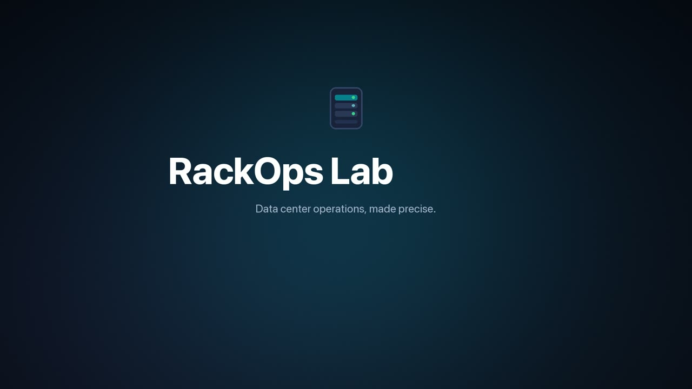
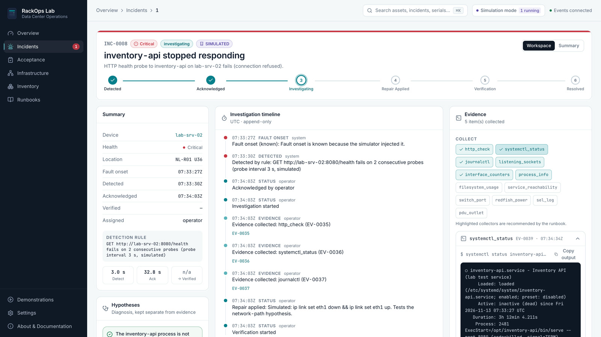
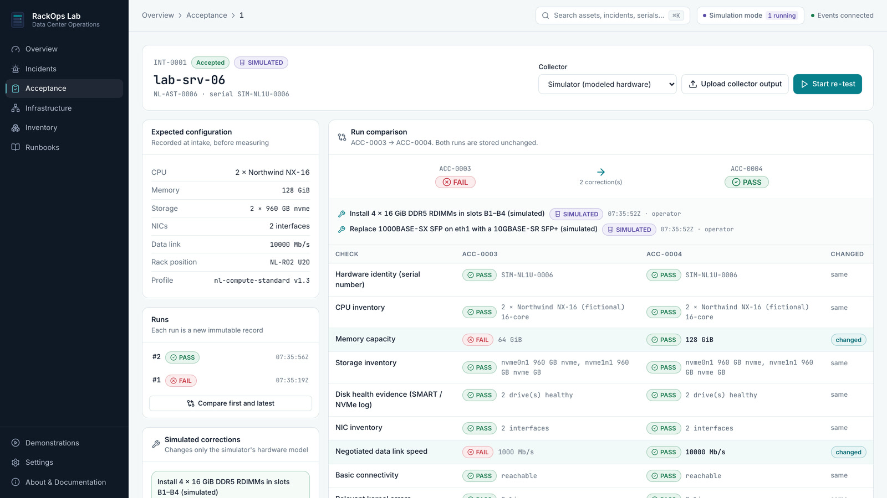
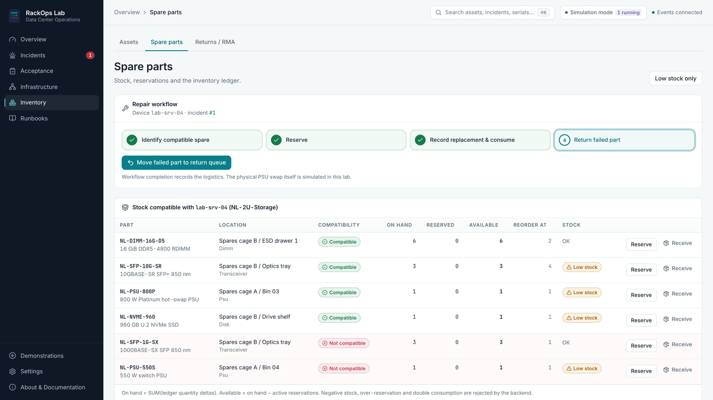
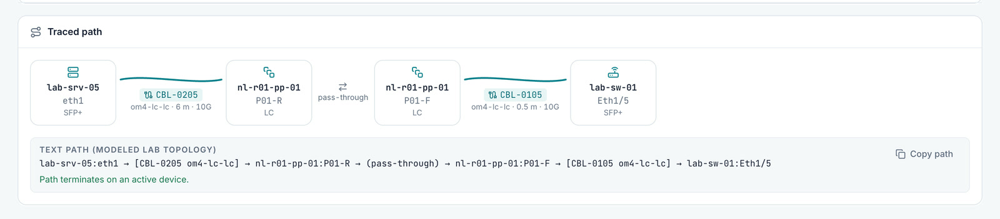
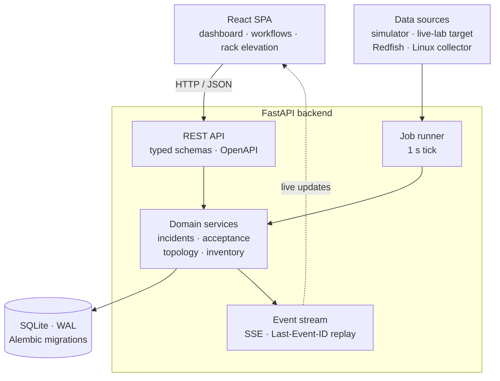
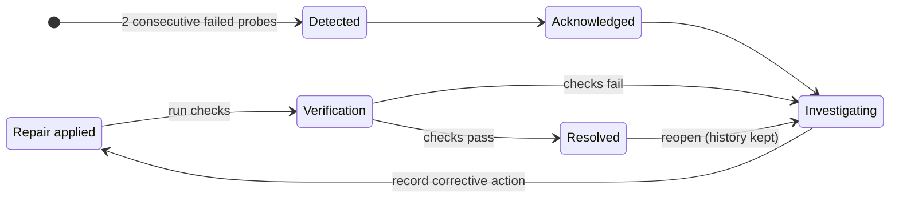
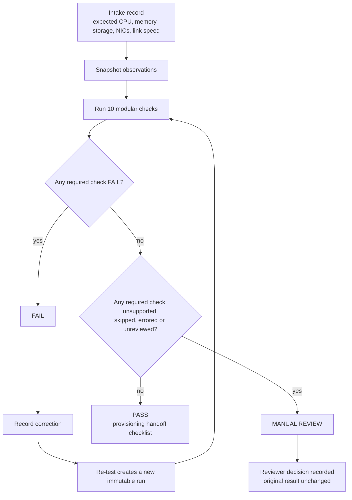
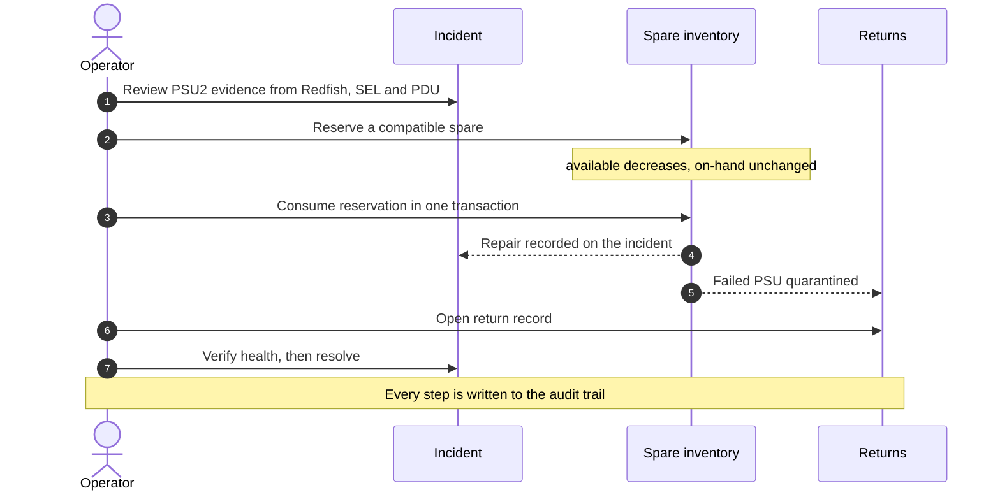

<div align="center">

# RackOps Lab

**Data center operations, made precise.**

Detect failures, prove recovery, accept hardware against its build sheet, and keep every rack, cable and spare part accounted for. One working application, one shared lab model.


[**Product tour**](#product-tour) · [**Features**](#what-it-does) · [**Architecture**](#architecture) · [**Quick start**](#quick-start) · [**Demos**](#guided-demonstrations) · [**Docs**](#documentation)

<br/>



</div>

<br/>

> [!NOTE]
> RackOps Lab is an independent lab project. All lab data is **synthetic**, and every measurement is labeled **SIMULATED**, **LOCAL LAB** or **IMPORTED SAMPLE**. Sources are never mixed into a single number.

---

## Product tour

<a href="frontend/public/media/rackops-tour.mp4">
  
</a>

<p align="center"><sub>▶ 70-second film of the real app (1080p, captions). It also plays from the hero on the app's homepage.</sub></p>

---

## What it does

<table>
<tr>
<td width="33%" valign="top">

### 🚨 Incident Detection & Recovery
A failed service is detected by deterministic probes, investigated with captured evidence, and resolved **only after verification passes**. A plausible wrong fix fails verification and goes back to investigation.

</td>
<td width="33%" valign="top">

### ✅ Server Intake & Acceptance
New servers are measured against their expected configuration through ten modular checks. Required failures **fail**; missing evidence goes to **manual review**; every re-test is a new, immutable run.

</td>
<td width="33%" valign="top">

### 🗄️ Rack, Cabling & Asset Lifecycle
An interactive rack elevation, end-to-end cable traces, power-independence analysis, and a **transactional** reserve → consume → return workflow with a complete audit trail.

</td>
</tr>
</table>

<table>
<tr>
<td width="50%"><p align="center"><sub><b>Investigation workspace</b>: timeline, evidence, hypotheses, runbook</sub></p></td>
<td width="50%"><p align="center"><sub><b>Acceptance re-test</b>: FAIL → recorded corrections → PASS</sub></p></td>
</tr>
<tr>
<td width="50%"><p align="center"><sub><b>Repair workflow</b>: compatible spare, reserve, consume, return</sub></p></td>
<td width="50%"><p align="center"><sub><b>Cable trace</b>: server → patch panel → switch, with a text path</sub></p></td>
</tr>
</table>

---

## Architecture



| Layer | Responsibility |
|---|---|
| **Domain services** | Every rule lives server-side: lifecycle transitions, verification gate, disposition logic, compatibility checks, ledger math. |
| **Job runner** | Advances simulations, executes acceptance checks a few at a time, and probes the optional live-lab target. |
| **Event stream** | Every change writes a persisted event; clients resume from `Last-Event-ID`, so nothing is missed after a reconnect. |
| **Provenance** | Each measurement and evidence row stores `source_type`, `source_id`, a timestamp and its simulation run. |

---

## How the workflows behave

### Incident lifecycle

Resolution is gated on a **passing verification executed after the most recent repair**. Pressing a button never proves recovery.



### Acceptance decision



### Component replacement



---

## Engineering highlights

| | |
|---|---|
| 🧮 **Ledger-derived stock** | On-hand = sum of inventory transactions; available = on-hand − active reservations. No counters to drift. |
| 🔒 **Transactional writes** | Inventory mutations run in `BEGIN IMMEDIATE` transactions, so a stock check and the write can't race. |
| 🔁 **Idempotency keys** | Reserve, consume and run-start accept an `Idempotency-Key`; a retried request can't double-consume stock. |
| 🧾 **Immutable runs** | Acceptance runs snapshot the expected config, profile and observations; reports render from the stored run. |
| 🎯 **Deterministic simulation** | Fixed sequences, no random numbers: the same drill always produces the same evidence and timings. |
| 🧹 **Isolated reset** | Demo reset removes only simulation-owned records; imported and local-lab evidence is never touched. |
| 🔌 **Honest integrations** | Redfish is GET-only with TLS verification on; unconfigured integrations say so instead of faking success. |
| ♿ **Accessible by default** | Status always has text, the rack has a table equivalent, keyboard navigation, reduced-motion support, WCAG AA contrast. |

---

## Quick start

**Prerequisites:** Python 3.12 with [uv](https://docs.astral.sh/uv/) and Node.js 20+.

```bash
# 1. Backend: API on http://127.0.0.1:8000 (interactive docs at /api/docs)
cd backend
uv sync
uv run alembic upgrade head
uv run python -m app.seed
uv run uvicorn app.main:app --host 127.0.0.1 --port 8000
```

```bash
# 2. Frontend: app on http://127.0.0.1:5173
cd frontend
npm ci
npm run dev
```

<details>
<summary><b>Docker Compose</b></summary>

```bash
cp .env.example .env
docker compose up --build                        # app on http://127.0.0.1:8080
docker compose --profile monitoring up --build   # adds Prometheus, Alertmanager, Node Exporter
```

All ports are published on `127.0.0.1` only.
</details>

<details>
<summary><b>Connect real lab equipment (optional)</b></summary>

| Source | How |
|---|---|
| **Live service drill** | Settings → Live lab. The backend starts its own HTTP target on `127.0.0.1:18081`. Stopping it causes a real outage that real probes detect. |
| **Linux server acceptance** | Run `python3 collectors/rackops_collect.py --data-iface eth1 > obs.json` on the machine (sudo adds SMART and dmesg), then upload it on the intake page. |
| **Redfish BMC** | Set `RACKOPS_REDFISH_URL`, `_USERNAME`, `_PASSWORD` in `.env`. Read-only; no power or firmware actions exist. |
| **Alertmanager** | Use the `monitoring` profile and set `RACKOPS_ALERTMANAGER_WEBHOOK_ENABLED=true` with a token. |
</details>

---

## Guided demonstrations

Start any demo from **Demonstrations** in the sidebar. A compact control bar guides each step, and every step runs the real backend workflow.

| Demo | Duration | What you see |
|---|---|---|
| **Restore a failed service** | ~2 min | Fault injected → detected in 3 s → evidence → wrong fix rejected by verification → correct fix → verified recovery → post-incident summary |
| **Reject and re-test a server** | ~2 min | Expected 128 GiB / 10 Gb/s, observed 64 GiB / 1 Gb/s → FAIL → recorded corrections → PASS → side-by-side diff and printable report |
| **Replace a failed component** | ~2 min | PSU2 fault → compatible spare → reserve → atomic consume → return record → health re-check → full audit trail |

---

## Testing

```bash
cd backend  && uv run pytest            # 40 workflow and integrity tests
cd frontend && npx vitest run           # component and formatting tests
cd frontend && npx playwright test      # demo journeys, routing, product tour, 13 pages × 3 viewports
cd frontend && npm run contrast         # WCAG AA check of the color tokens
```

Playwright starts an isolated backend and frontend on separate ports with their own database.

---

## Project structure

```text
RackPilot/
├── backend/
│   ├── app/
│   │   ├── models.py            # shared data model with provenance and constraints
│   │   ├── services/            # incidents, simulation, acceptance, topology, inventory, demos
│   │   ├── acceptance/checks.py # modular checks and disposition rules
│   │   ├── collectors/          # simulated evidence, read-only Redfish adapter
│   │   ├── routers/             # REST API (OpenAPI at /api/docs)
│   │   └── runner.py            # background job runner
│   ├── alembic/                 # migrations
│   └── tests/                   # pytest suite
├── frontend/
│   ├── src/pages/               # dashboard and workflow pages
│   ├── src/components/          # rack elevation, cable trace, product tour, UI kit
│   ├── public/media/            # product film, preview loop, captions
│   └── e2e/                     # Playwright specs
├── collectors/rackops_collect.py  # read-only Linux hardware collector
├── docs/                        # architecture, runbooks, case studies, screenshots
├── infra/                       # Prometheus and Alertmanager configuration
├── media/source/                # scripts that render the product film
└── docker-compose.yml
```

---

## Documentation

| Topic | |
|---|---|
| Architecture and decisions | [docs/architecture.md](docs/architecture.md) · [docs/implementation-plan.md](docs/implementation-plan.md) |
| Data model | [docs/data-dictionary.md](docs/data-dictionary.md) |
| Simulation model | [docs/simulation-model.md](docs/simulation-model.md) |
| Technical walkthrough | [docs/technical-walkthrough.md](docs/technical-walkthrough.md) |
| Runbooks | [docs/runbooks/](docs/runbooks/) |
| Case studies | [docs/case-studies/](docs/case-studies/) |
| Demo script | [docs/demo-script.md](docs/demo-script.md) |
| Evidence export | [docs/evidence-export.md](docs/evidence-export.md) |
| Known limitations | [docs/limitations.md](docs/limitations.md) |
| Test results | [docs/test-results.md](docs/test-results.md) |

<br/>

<div align="center">
<sub>RackOps Lab · built with FastAPI, React and SQLite · demonstrated with simulated lab data</sub>
</div>
