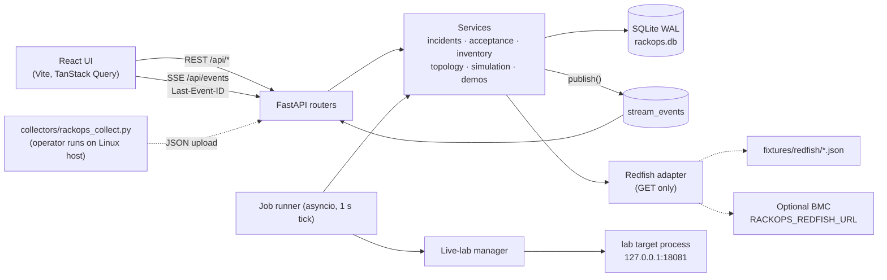

# RackOps Lab: Architecture

RackOps Lab is a local, single-user web application. It runs one backend process (FastAPI with an in-process job runner) and one frontend (React, served by Vite in development). All state lives in one SQLite database. Nothing requires external accounts or paid services.

> Independent interview lab. All topology, serial numbers and addresses are synthetic. No production use is claimed.

## Components

| Component | Location | Responsibility |
|---|---|---|
| React UI | `frontend/src/` | Pages, rack elevation, demo dock, charts. TanStack Query for server state. One shared `EventSource` (`lib/sse.ts`) invalidates queries when events arrive. |
| FastAPI routers | `backend/app/routers/` | `platform.py` (overview, search, audit, demos, settings, integrations, SSE), `incidents.py`, `acceptance.py`, `infra.py` (racks, devices, cables, power, assets, spares, reservations, returns). Typed request bodies are in `schemas.py`. The OpenAPI document is at `/api/openapi.json` and the UI at `/api/docs`. |
| Services | `backend/app/services/` | All business rules: `incidents.py` (lifecycle and verification gate), `simulation.py` and `scenarios.py` (deterministic engine), `acceptance.py`, `inventory.py` (ledger, reservations, returns, lifecycle), `topology.py` (placement, cables, trace, power), `demos.py` (guided demos), `common.py` (audit, display IDs, idempotency, stream events). |
| Acceptance checks | `backend/app/acceptance/checks.py` | Ten modular checks plus the disposition rules. |
| Collectors | `backend/app/collectors/` | `sim_evidence.py` (state-rendered evidence), `redfish.py` (GET-only adapter: fixture mode or a live endpoint). The operator-run Linux collector is in the repository root: `collectors/rackops_collect.py`. |
| Job runner | `backend/app/runner.py` | One asyncio loop, ticking once per second (`RACKOPS_RUNNER_TICK_SECONDS`). Each tick advances due simulation runs, executes up to 2 pending acceptance checks per run, and probes the live-lab target if it is enabled. Each unit of work runs in its own short write transaction. |
| Live-lab manager | `backend/app/livelab/` | Optional. Starts and stops a lab-owned HTTP process (`target.py`) on `127.0.0.1:18081`. Its observations are real and labeled `LOCAL_LAB`. |
| Database | SQLite (`backend/data/rackops.db`), WAL mode | Schema is managed by Alembic (`backend/alembic/`). Seeded by `python -m app.seed`. |

## Request and transaction model

- **Read requests** use `get_db()`: a deferred SQLite transaction. In WAL mode, readers never block writers.
- **Mutating requests** use `get_write_db()` (`backend/app/db.py`). It opens the connection with `execution_options={"sqlite_immediate": True}`, and the engine `begin` hook then issues `BEGIN IMMEDIATE`. The write lock is held from the first statement, so a stock check and the inserts that follow cannot interleave with another writer. Every route with `dependencies=[Depends(require_mutations)]` uses the write session.
- Handlers call `db.commit()` explicitly. A `DomainError` leaves the transaction uncommitted, so nothing is written, and the error is returned in a consistent envelope: `{"error": {"code", "message", "detail"}}`. Validation errors use the same envelope with `code: "validation_error"`.
- **Idempotency.** `POST /api/reservations`, `POST /api/reservations/{id}/consume` and `POST /api/acceptance/intakes/{id}/runs` accept an `Idempotency-Key` header. The first response is stored in `idempotency_keys`. A repeated key returns the stored response. A repeated key with a different body returns 422.

## Server-sent events

`common.publish()` inserts a row into `stream_events` **inside the caller's transaction**, so an event only exists if the change that produced it committed. `GET /api/events` tails the table every 0.5 s and writes `id:`, `event:` (topic) and `data:` lines. It sends a keep-alive comment every 15 s. Clients resume from the `Last-Event-ID` header or the `last_event_id` query parameter, and missed events are replayed. At startup, rows older than the most recent 20,000 are pruned. The UI shows the stream state (Live / Reconnecting / Offline) and a stale-data banner when offline.

## Provenance model

| Field | Values | Meaning |
|---|---|---|
| `source_type` | `SIMULATED`, `LOCAL_LAB`, `IMPORTED_SAMPLE` | Where a measurement, piece of evidence, incident or acceptance run came from. Required on incidents, evidence, metric observations, acceptance runs, check results and verifications. |
| `source_id` | string | The specific producer, e.g. `sim:svc-stopped:SIM-0001:systemctl_status`, `livelab:http://127.0.0.1:18081/health`, `redfish-fixture:/redfish/v1/Systems/1`. |
| `collected_at` / `observed_at` / `executed_at` | UTC | When the observation was taken. |
| `simulation_run_id` | FK, nullable | The owning simulation run. Deleting the run cascades to its records. |
| `origin` | `seed`, `simulation`, `operator`, `imported`, `local_lab` | Who owns the row. Used by reset. |

Aggregates are always computed per `source_type` (`services/incidents.py: aggregate_metrics`). No combined figure exists. Missing values are stored as `NULL` and shown as "Unknown" or "Not collected", never as zero. The seeded topology is labeled **Modeled lab topology** in the UI.

## Reset semantics

- `POST /api/simulation/reset` (`simulation.reset_all`) deletes every `simulation_runs` row. Database cascades remove the records each run owns. It then deletes any remaining rows with `origin = 'simulation'` and all `SIMULATED` metric observations, and calls `seed.restore_seed_baseline()`. That function re-applies seed values to seed-owned mutable fields (device health, PSU asset status and placement, power-input component links, intake simulator hardware and corrections), keeping IDs stable.
- Stock needs no restore. It is derived from the ledger, so removing simulation transactions and reservations returns quantities to their correct values.
- `IMPORTED_SAMPLE`, `LOCAL_LAB` and operator-created rows are never deleted. `tests/test_demos.py::test_reset_is_isolated_to_simulation_data` checks this.
- Restarting a guided demo purges only that demo's previous runs (`demos.start`).
- `python -m app.seed --reset` drops **all** data, after an interactive confirmation.

## Security boundaries

- **Localhost by default.** Vite binds `127.0.0.1:5173` and the documented uvicorn command binds `127.0.0.1:8000`. CORS allows only `RACKOPS_FRONTEND_ORIGIN`.
- **No remote shell.** No endpoint executes commands from input. Commands shown with evidence are display strings. The live-lab target is launched with a fixed argv list (`sys.executable -m app.livelab.target --port N --log PATH`). Stop sends SIGTERM only to the PID the lab started, and only after the `/health` marker matches.
- **Redfish is read-only.** `RedfishClient` implements only `get()`, restricted to `/redfish/v1` paths. TLS verification is on by default. `describe()` never returns credentials.
- **Uploads.** JSON only, at most `RACKOPS_MAX_UPLOAD_BYTES` (512 KiB). Unknown sections are rejected. Strings are truncated and `password|token|secret|authorization=…` patterns are redacted (`acceptance.sanitize_upload`). Live-lab log lines are sanitized the same way.
- **Secrets** come from environment variables or `.env` (`config.py`, prefix `RACKOPS_`). They are not stored in the database or returned by the API.
- **Public preview.** `RACKOPS_PUBLIC_PREVIEW=true` makes every mutation and collection endpoint return 403 (`deps.require_mutations`).
- **Integrations are off unless configured.** The Alertmanager webhook is disabled by default and can require a bearer token. NetBox is file import only. Jira is file export only. Notifications are disabled.
- **Live collection is opt-in.** The live lab is disabled until the operator enables it in Settings. The Linux collector runs only where the operator runs it.

## Architectural decisions

See [implementation-plan.md](implementation-plan.md) for the full AD-1 to AD-13 table. In summary: DB-persisted deterministic simulation, no randomness, provenance on every measurement, `origin`-based reset, ledger-derived stock, idempotency keys, a verification gate, immutable acceptance snapshots, persisted SSE events, a self-contained live lab, a GET-only Redfish adapter, `BEGIN IMMEDIATE` for writes, and status shown in text as well as color.
